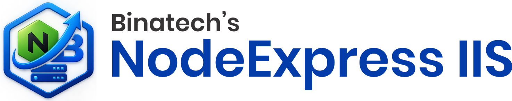

# NodeExpress IIS

**Publish, deploy and recover Node.js / React / Angular / Next.js projects on Windows Server — powered by PM2 and IIS.**

By **Binatech Solutions** · Website: [binatechs.in](https://binatechs.in/contact) · Contact: [binatechsolution@gmail.com](mailto:binatechsolution@gmail.com) · GitHub: [akash-awaskar/NodeExpressIIS](https://github.com/akash-awaskar/NodeExpressIIS)

## Overview

NodeExpress IIS is a Windows desktop tool that moves web projects from a development PC to a Windows Server and keeps them running:

- **Publish Project** — builds your Node / React / Angular / Next / Nuxt project on the dev PC and prepares a publish folder with a `publish-info.json` manifest.
- **Deploy Project** — on the server, it finds a free port, runs server apps under **PM2**, serves static builds directly through **IIS**, and sets up an IIS **URL Rewrite reverse proxy** automatically.
- **Recover** — after a server reboot it restores all PM2 apps (`pm2 resurrect`), enables `pm2-windows-startup`, enables ARR proxy, starts all IIS sites and restarts IIS.

**License:** the tool signs in with your Binatech Solutions account (email + password). The licensing service must be reachable at `http://localhost:3000` on the machine where the tool runs.

## Features

- Three modes: Publish, Deploy, Recover
- Automatic free-port detection (optional front-end port change)
- PM2 process management with strict online + port verification
- Automatic IIS URL Rewrite reverse proxy and `web.config` generation
- One-click reboot recovery
- Framework detection from `package.json` (Node, React, Angular, Next, Nuxt)
- Timestamped per-run logs in the `logs` folder
- Modern, card-based UI with splash, about and how-to-use dialogs

## Prerequisites

**Development PC**

- Windows 10 / 11 or Windows Server
- .NET Framework **4.7.2** (the installer checks and prompts if missing)
- Node.js + npm (for the project you publish)

**Windows Server (target)**

- Windows Server 2016 or later
- .NET Framework 4.7.2
- Node.js + npm
- IIS with the **URL Rewrite** and **Application Request Routing (ARR)** modules
- PM2 (`npm install -g pm2`)
- The NodeExpress licensing service running on `localhost:3000`

## Installation

1. Download `NodeExpressIIS.msi`.
2. Run the installer. Default folder: `C:\Program Files\NodeExpress IIS`.
3. The installer checks for .NET Framework 4.7.2 and stops with a clear message if it is missing — install .NET Framework 4.7.2 and run the MSI again.
4. A **NodeExpress IIS** entry is added to the Start Menu, with an uninstall shortcut.

> **Run the tool as Administrator** — Deploy and Recover modify PM2, IIS and URL Rewrite, which require elevated rights.

## Usage

### 1. Sign in

Launch NodeExpress IIS from the Start Menu and sign in with your Binatech Solutions email and password. Use *Remember me* to skip the sign-in next time (the tool stores a small flag file next to the executable, so keep the install folder writable or run the tool as Administrator).

### 2. Publish (dev PC)

1. Choose **Publish Project**.
2. Enter your project path and a publish folder.
3. The tool installs missing dependencies if needed, runs `npm run build`, and writes the publish folder with `publish-info.json`.
4. Copy the publish folder to your Windows Server.

### 3. Deploy (server)

1. Choose **Deploy Project** (run as Administrator).
2. Enter the published folder path and the IIS site name (created in IIS beforehand).
3. The tool picks a free port: static builds are served by IIS directly; server apps run under PM2 and the IIS site reverse-proxies to them.
4. Optionally set or change the IIS front-end port.

### 4. Recover (server, after a reboot)

1. Choose **Recover** (run as Administrator).
2. PM2 apps are restored, `pm2-windows-startup` is installed if missing, ARR proxy is enabled, and all IIS sites are started.

## Troubleshooting

| Problem | Solution |
|---|---|
| “Cannot connect to the API at http://localhost:3000” | The licensing service is not running on this machine. Start it and sign in again. |
| “Invalid email or password” | Check your Binatech Solutions credentials. Contact us if your license has expired. |
| “License expires in X days” (orange warning) | Your license is expiring soon — click Login again to continue, and contact Binatech Solutions to renew. |
| “Expired. Please contact Binatech Solutions.” | The license has expired — contact us for a renewal. |
| Deploy fails with port errors | Another app is using the port. The tool normally picks a free port automatically — check the log in the `logs` folder. |
| Deploy/Recover does nothing | Run the tool as Administrator (right-click → Run as administrator). |
| IIS site returns 502 / does not proxy | Make sure the URL Rewrite and ARR modules are installed in IIS, then use **Recover**. |
| PM2 app not listed after reboot | Use **Recover** — it installs `pm2-windows-startup` so apps survive future reboots. |
| SmartScreen / antivirus prompt on first run | The file is unsigned. Click *More info → Run anyway*. See “Code signing” below. |

Detailed per-run logs are written to `logs\` next to the executable — attach them when contacting support.

## Uninstall

Open **Settings → Apps → Apps & features** (or Control Panel → Programs and Features), select **NodeExpress IIS**, and choose **Uninstall**. An uninstall shortcut is also available in the Start Menu under *Binatech Solutions → NodeExpress IIS*.

## Code signing

The release is currently **unsigned**, so Windows SmartScreen shows a one-time “Windows protected your PC” prompt on first run (*More info → Run anyway*). To remove the prompt for customers:

- **Free option:** none trusted. A self-signed certificate is free, but every client machine must manually trust it, and SmartScreen still warns.
- **Paid option:** an OV code-signing certificate (~$200–500/year) or EV certificate (~$400–700/year) from a public CA (Sectigo, SSL.com, DigiCert). Sign the EXE and the MSI with `signtool.exe` (from the Windows SDK). EV certificates build SmartScreen reputation almost immediately; OV takes a few weeks.

## About

**Binatech Solutions** — Windows deployment and DevOps tooling.

- Email: [binatechsolution@gmail.com](mailto:binatechsolution@gmail.com)
- Website: [binatechs.in/contact](https://binatechs.in/contact)
- GitHub: [akash-awaskar/NodeExpressIIS](https://github.com/akash-awaskar/NodeExpressIIS)

&copy; 2026 Binatech Solutions. All rights reserved.
